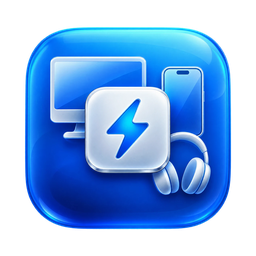
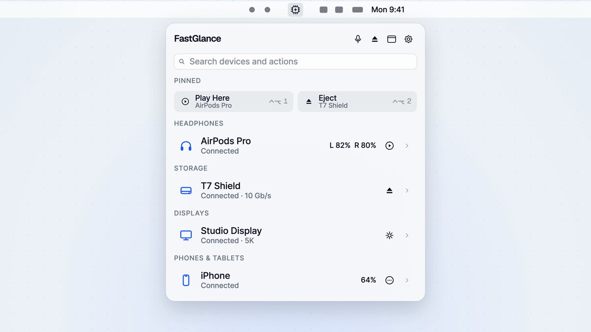

<p align="center">
  
</p>

<h1 align="center">FastGlance</h1>
<p align="center">Your Mac’s devices, one menu away.</p>
<p align="center">
  <a href="https://github.com/MlayKlayer/FastGlance/actions/workflows/ci.yml"></a>
  
  
  <a href="LICENSE"></a>
</p>

<p align="center">
  <a href="docs/media/launch-film.mp4"></a>
  <br><sub><a href="docs/media/launch-film.mp4">▶ Watch the 15-second launch film</a></sub>
</p>

FastGlance is a native macOS menu bar utility for finding connected devices, checking their status, and taking quick actions. It brings Bluetooth, USB, audio, disks, displays, cameras, printers, and local network discovery into one place, with a history of previously seen devices.

**Early beta · 0.1.0.** Build from source using the instructions below. No notarized installer is currently provided. Device support varies; the automated tests do not replace real hardware testing.

## What you can do

- **Find devices and actions.** Search by name, category, IP or MAC address, or type an action such as `eject SSD`. Use the arrow keys and Return to select an action.
- **Keep favourites close.** Pin actions, reorder them, give them custom titles, and run the first nine with global shortcuts. Unavailable pins stay visible with a reason.
- **Make the list yours.** Give devices nicknames, hide individual devices or categories, and browse offline devices in Recently Seen.
- **Switch audio quickly.** Connect Bluetooth headphones with Play Here, choose inputs and outputs, adjust supported volume controls, and toggle microphone mute.
- **Manage external disks.** Eject one or all disks, see action progress and errors, and enable an attempt to unmount local external volumes before lid-close sleep and remount them after wake.
- **Understand USB links.** USB Doctor shows negotiated speeds and explains likely cable or hub bottlenecks for supported devices.
- **Control displays.** Adjust supported brightness, resolution, mirroring and the main display. Compatible external monitors also expose DDC brightness, contrast, volume and input controls, plus brightness sync with the built-in screen.
- **Check your connection.** See Wi-Fi signal and link details, Ethernet status, and a session traffic counter for Wi-Fi connections identified as metered/hotspot connections.
- **Discover your LAN.** Find Bonjour services and IPv4 neighbours; open advertised web, SMB, SSH or Screen Sharing services, ping hosts, and send Wake-on-LAN packets.
- **Use device-specific tools.** Preview a camera in a separate window, inspect CUPS print queues and ink levels, or try supported game-controller lights and vibration.
- **Stay informed.** Battery indicators, grouped connection notifications, inline action results and retry buttons keep routine changes visible. Settings → Access explains permission and display-control availability.

## Requirements

- Apple Silicon Mac running macOS 14 Sonoma or later.
- Xcode 16 or later, selected as the active developer directory.
- [XcodeGen](https://github.com/yonaskolb/XcodeGen).

There are no third-party Swift package dependencies. XcodeGen generates the Xcode project from `project.yml`.

## Build and run

```sh
git clone https://github.com/MlayKlayer/FastGlance.git
cd FastGlance
brew install xcodegen
xcodegen generate -q
xcodebuild -project FastGlance.xcodeproj -scheme FastGlance \
  -destination 'platform=macOS,arch=arm64' -derivedDataPath build build
```

The default build uses an ad-hoc signature, so an Apple Developer account is not required for a local build. For a development certificate, pass `CODE_SIGN_IDENTITY="Apple Development" DEVELOPMENT_TEAM="YOUR_TEAM_ID"` to `xcodebuild`. Keep signing credentials out of the repository.

Quit any running copy, then copy `build/Build/Products/Debug/FastGlance.app` into `~/Applications` using Finder and open it there. Keep a single installed copy: launch-at-login registers the app’s path. Rebuilding with a different signing identity can affect macOS permission grants.

FastGlance opens in the menu bar rather than the Dock. Click its icon to browse; right-click for the device window, Settings or Quit. Option-click runs the first pinned action.

## Keyboard shortcuts

| Shortcut | Action |
| --- | --- |
| Control–Option–1 … 9 | Run the corresponding pinned action |
| Control–Option–M | Toggle microphone mute |
| Up / Down, Return | Select and run an action search result |
| Escape | Clear the search, or dismiss the menu |

Global shortcuts can be disabled in Settings. Another app can already own a shortcut; macOS keyboard behavior should be checked on your version.

## Permissions and privacy

FastGlance is not sandboxed. macOS gates Bluetooth discovery, local network access, Wi-Fi names (Location), camera previews and notifications behind permissions. Camera access is requested when you ask for a preview. Check Settings → Access if a feature is unavailable.

The app code contains no analytics, accounts or cloud sync. Device history is stored locally at:

```text
~/Library/Application Support/FastGlance/history.json
```

History includes device identifiers, names, categories, last-connected times, nicknames and hidden state. Preferences and pins live in macOS UserDefaults. Discovery sends traffic to network devices, and actions such as Ping, Wake-on-LAN and opening a service communicate with their targets. Scanning can be disabled; Bonjour browsing and targeted address lookups for advertised hosts still operate.

Before sharing screenshots, logs or raw device properties, remove serial numbers, device addresses and network names.

## Current limitations

- **Microphone mute is best effort.** It attempts to mute controllable physical inputs; non-default virtual/aggregate inputs are skipped. Newly connected microphones are not automatically muted, write failures may not be reported, and the red indicator reflects the default input only. It is not a guarantee that every recording source is silent.
- **Lid-close protection is best effort.** Busy disks may stay mounted and the wait is capped at 10 seconds. Timeout/late-completion handling and real sleep/wake behavior need further testing. Closing the lid alone is not confirmation that a drive is safe to unplug; use a successful explicit eject when you need certainty.
- **Network discovery is approximate.** ARP entries may linger after a device leaves. Scanning covers IPv4 and is capped at a /22; multiple interfaces, VPNs, address changes and failed MAC lookups can affect discovery or history identity. Metered Wi-Fi is currently labelled as an iPhone hotspot even when the access point is something else. Its traffic counter measures interface bytes, not carrier billing.
- **Display support depends on hardware.** DisplayServices and IOAVService are private APIs loaded dynamically. Unsupported controls disappear, and macOS changes can break them. Monitor pairing uses identity matching with an order fallback; identical monitors without unique serials can change identity when the connected set changes. DDC values can lag changes made using a monitor’s own buttons. Brightness sync needs an active built-in screen.
- **History remembers system devices.** Paired Bluetooth devices and installed printer queues remain listed until removed in macOS settings. Clearing history does not unpair or uninstall them.
- **Hardware coverage is still limited.** AirPods routing, DDC, lid protection, controller features, printer behavior and popover keyboard interaction need testing across more devices. See [Contributing](CONTRIBUTING.md) to report results.

## Development

```sh
xcodegen generate -q
xcodebuild -project FastGlance.xcodeproj -scheme FastGlance \
  -destination 'platform=macOS,arch=arm64' -derivedDataPath build test
```

The generated `.xcodeproj`, build output and local session notes are ignored. Edit `project.yml` for build settings and regenerate after adding or removing source files. CI builds and runs the unit tests on an Apple Silicon macOS runner with an ad-hoc signature.

See [Contributing](CONTRIBUTING.md), [security reporting](SECURITY.md), and [release preparation](docs/RELEASING.md).

## License

[MIT](LICENSE) © 2026 MlayKlayer.
